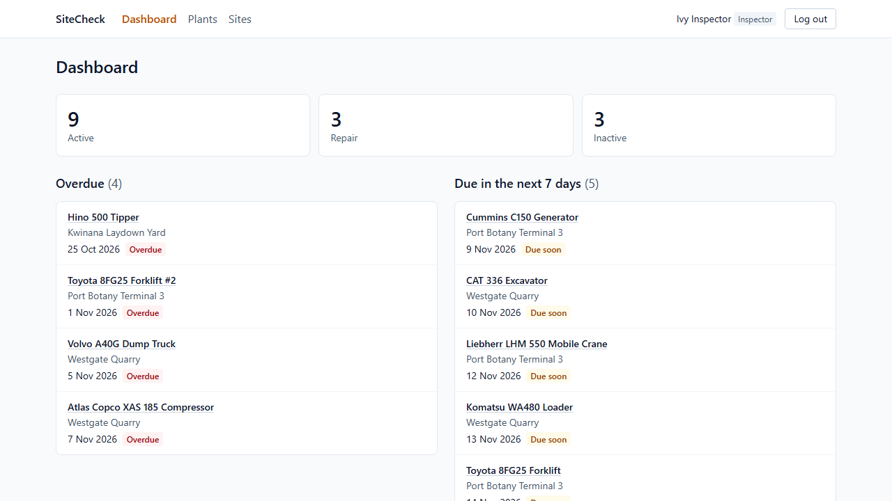
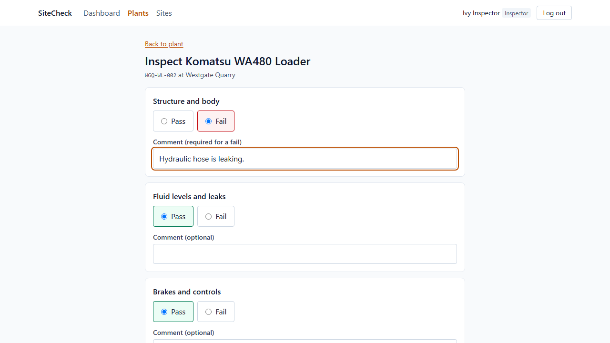
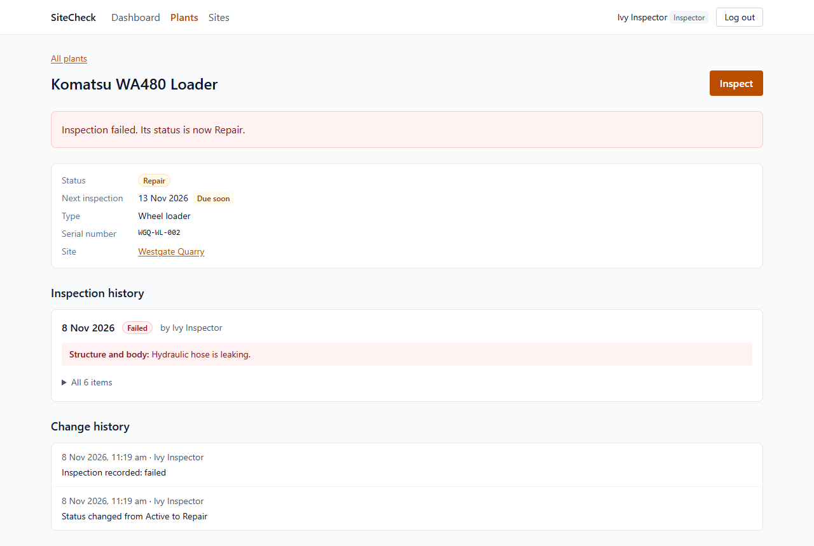
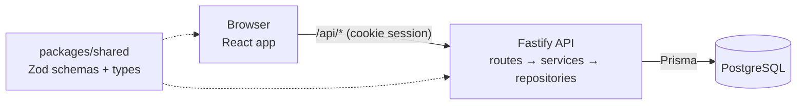

# SiteCheck

[](https://github.com/alankhen2/sitecheck/actions/workflows/ci.yml)

SiteCheck keeps track of the heavy plant (loaders, excavators, cranes) at each work site, and of their safety inspections: who inspected what, what failed, and which plant is due next.

It is a portfolio project. The goal was a small app built the way a team would build a real one, with tests, access control and an audit trail, rather than a long feature list.

## Demo

<!-- Demo video goes here (uploaded through GitHub's README editor). -->

A one-minute walk through the app: an inspector records a failed inspection, then the read-only demo account looks around and cannot change anything.

| Dashboard                                                                               | Recording an inspection                                                                  | After saving                                                                               |
| --------------------------------------------------------------------------------------- | ---------------------------------------------------------------------------------------- | ------------------------------------------------------------------------------------------ |
|  |  |  |

The video and screenshots are made by a Playwright script (`pnpm demo:record`), so they can be recorded again after any change, and the recording fails if the flow breaks.

The app is not hosted online; see [Next steps](#next-steps). Run it locally to try it. The seed creates three accounts:

| Account                   | Role      | Can do                                                          |
| ------------------------- | --------- | --------------------------------------------------------------- |
| `admin@sitecheck.dev`     | Admin     | Everything an inspector can, plus delete plant and manage sites |
| `inspector@sitecheck.dev` | Inspector | Add and edit plant, record inspections                          |
| `demo@sitecheck.dev`      | Viewer    | Look at everything, change nothing                              |

Passwords come from `SEED_PASSWORD` and `DEMO_PASSWORD` in `apps/api/.env`.

## What it does

- **Sites and plant:** each plant belongs to a site and has a status (Active, Repair, Inactive) and a next inspection date. The list has search, filters, sorting and pagination.
- **Inspections:** a six-item checklist, each item pass or fail. A failed item needs a comment. A failed inspection puts the plant in Repair and keeps it due; a passed one makes it Active and sets the next inspection 30 days later.
- **Dashboard:** plant counts by status, overdue inspections, and inspections due in the next 7 days.
- **History:** every change to a plant and every inspection is recorded with who did it and the old and new values.
- **Roles:** admin > inspector > viewer, checked by the API on every request, not only by hiding buttons.

## Tech stack

| Part    | Tools                                                                                   |
| ------- | --------------------------------------------------------------------------------------- |
| Web     | React 19, TypeScript, Vite, React Router, TanStack Query, React Hook Form, Tailwind CSS |
| API     | Node, Fastify 5, Prisma 7, PostgreSQL 18                                                |
| Shared  | Zod 4 schemas, used by both web and API                                                 |
| Tests   | Vitest, Testing Library, MSW, axe-core, Supertest, Playwright                           |
| Tooling | pnpm workspaces, ESLint (type-aware), Prettier, GitHub Actions, Docker Compose          |

## Architecture



A pnpm monorepo with three packages:

- `apps/web`: the React app. In development, Vite proxies `/api/*` to the API, so the browser only ever talks to one origin.
- `apps/api`: Fastify. Routes are thin: they validate input and call services. Services hold the business rules and depend on repository interfaces. Repositories are the only code that talks to Prisma.
- `packages/shared`: the Zod schemas for every request and response. The API validates with them, and the web app parses API responses with them, so both sides agree on one definition.
- `apps/e2e`: Playwright tests of whole flows in a real browser.

## Technical decisions

- **Business rules in services, behind repository interfaces.** Rules such as "a failed inspection puts the plant in Repair" are unit tested with in-memory fakes, no database needed. ([`inspections.service.ts`](apps/api/src/services/inspections.service.ts))
- **One schema for both sides.** Request bodies, queries and responses are Zod schemas in `packages/shared`. Anything from outside the process (requests, `fetch` results, environment variables) is typed `unknown` until a schema parses it.
- **Audit log in the same transaction.** Each plant or inspection write adds its history entry in the same database transaction, with the old values read under a row lock. A write cannot succeed without its history, and two writes at once cannot record the wrong "before".
- **Session in an httpOnly cookie, not localStorage.** Page JavaScript cannot read the token, so an XSS bug cannot steal it. `sameSite: strict` blocks cross-site requests. Sessions last one work shift (8 hours). ([`plugins/auth.ts`](apps/api/src/plugins/auth.ts))
- **Auth before validation.** Role checks run as `onRequest` hooks, so an unauthenticated caller gets 401 before the API says anything about the body.
- **Secure by default.** Registration is closed unless `ALLOW_REGISTRATION=true`, because new accounts are inspectors who can change data. `TRUST_PROXY` defaults to 0, so a client cannot fake its address with `X-Forwarded-For`.
- **Roles as an allowlist.** Each route names the roles it accepts. Adding the `VIEWER` role needed no route changes: it was refused everywhere until allowed.
- **Rate limits on login and register.** Per address and per account, counted in memory. That is right for one server; several servers would need a shared store (see Next steps).
- **A video instead of a free-tier deployment.** Free hosting means a cold start of about a minute on the first visit, and a free database that expires. A recorded demo shows the app reliably; the deployment plan is kept in Next steps.

## Tests

| Layer           | Count | What it checks                                                                                    |
| --------------- | ----- | ------------------------------------------------------------------------------------------------- |
| API unit        | 241   | Services with fake repositories; routes with `app.inject`                                         |
| Web unit        | 186   | Components and pages with Testing Library, the API mocked by MSW, accessibility with axe-core     |
| API integration | 115   | The real app and a real PostgreSQL database, including a matrix of every role against every route |
| End to end      | 4     | Whole flows in Chromium against the production web build                                          |

CI runs lint, typecheck, unit tests, integration tests, the build and the end-to-end tests on every push.

Beyond a passing suite, important tests were checked by mutation: the code was broken on purpose (for example, swapping the order of two hooks) to confirm that a test fails, and fails for the right reason.

## Running locally

Needs Node 24+, pnpm, and Docker.

```sh
pnpm install
docker compose up -d db                      # PostgreSQL on localhost:5432
cp apps/api/.env.example apps/api/.env       # then set JWT_SECRET (see the comment in the file)
pnpm --filter @sitecheck/api db:deploy       # apply migrations
pnpm --filter @sitecheck/api db:seed         # demo data: 3 users, 3 sites, 15 plants
pnpm dev                                     # web on http://localhost:5173, API on :3000
```

Other commands:

- `pnpm lint`, `pnpm typecheck`, `pnpm test`: what CI runs first.
- `pnpm test:integration`: against a separate `sitecheck_test` database, created automatically.
- `pnpm test:e2e`: Playwright, on its own ports and its own `sitecheck_e2e` database. Run `pnpm --filter @sitecheck/e2e exec playwright install chromium` once first.
- `pnpm demo:record`: record the demo video and the screenshots.

## How Claude Code was used

The code was written with [Claude Code](https://claude.com/claude-code), working to these rules:

- **Rules in [`CLAUDE.md`](CLAUDE.md):** strict TypeScript without `any`, every input validated with a shared schema, business rules with tests written first, no raw HTML from user text, no secrets in git, Actions pinned to a commit SHA, a plan before any change to more than three files.
- **Plan first, then code.** Each step started with a written plan that I approved. Product decisions, such as the read-only demo role, closed registration and a video instead of hosting, were mine.
- **Small commits, checks before each one:** format, lint, typecheck, tests, and integration tests when the API changed.
- **Proof, not trust.** Tests were mutation-checked as described above, and changes were also tried in a real browser.
- **A learning log.** Every change came with a written chapter on the code, the concepts behind it and the trade-offs, which I study to be able to explain and change any part myself.

## Next steps

- **Deploy.** Researched plan: web on Vercel, API on Render, database on Neon, all on free tiers. Neon rather than Render's database, because Render's free database is deleted after 30 days plus a 14-day grace period. It also needs `Cache-Control: no-store` on API responses, a shared secret so the API only accepts traffic through Vercel, and `TRUST_PROXY` measured on the real proxies.
- **Shared rate limit store** (for example Redis), so limits hold across several API servers and restarts.
- **Left out of this version on purpose:** photo uploads, email reminders for due inspections, several companies in one app (multi-tenancy), a mobile app, and live updates.
